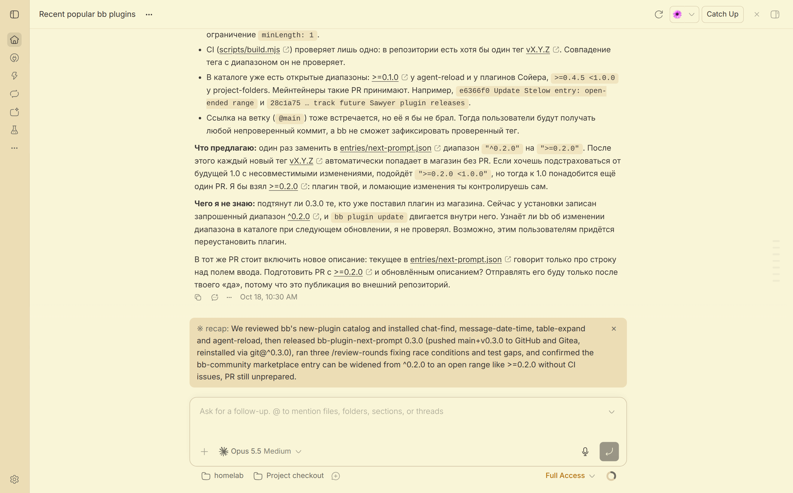
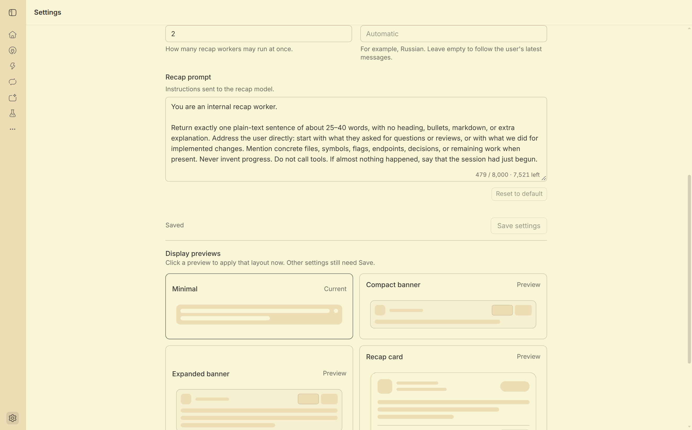

# Catch Up

A short recap above the composer, so you can pick up a [bb](https://getbb.app) thread without rereading it.



Catch Up stores each recap in its own database, so a recap never enters the thread's transcript or model context.

## Features

- **Minimal card by default.** Only the recap and a × button, with no border, buttons, or model details. Close it when you have read it: it stays closed on every device until a newer recap replaces it.
- **Other layouts.** A compact banner, a banner that opens expanded, a larger card, or no inline recap until you open the panel.
- **Automatic recaps.** One runs after a visible thread goes idle and reaches the minimum number of user turns. A thread with a running child thread stays active. A new turn hides the old recap until the next one is ready.
- **Your language.** Each recap follows the language of your latest messages, and the plugin checks the writing system of the result. To use one language in every thread, set **Recap language** in settings.
- **Small refreshes.** The next recap sends the previous recap plus the new turns, not the whole transcript again.
- **Preview.** `bb catchup preview` shows the card at once, with no model call, even while the thread is active.

## Install

```sh
bb plugin install git:https://github.com/CrazyCoder/bb-plugin-catchup --yes
```

Open a thread and choose **Catch Up** in its header or in the command palette.

From a local clone:

```sh
git clone https://github.com/CrazyCoder/bb-plugin-catchup.git
cd bb-plugin-catchup
npm ci
bb plugin build
bb plugin install path:$PWD --yes
```

Requires bb 0.48 or newer.

If you also run the Recap plugin this one is based on, remove it first: otherwise each thread gets recaps from both.

## Where to find it

| Where | What |
| --- | --- |
| Thread header | Open the Catch Up panel and generate a recap. |
| Command palette | Choose **Catch Up: generate a recap for this thread**. |
| Composer | Read the latest recap. Choose **On demand** to keep it out of the composer. |
| Plugin settings | In **Recap behavior**, choose a model and configure automatic generation, cleanup, language, prompt, and display. |
| CLI | Generate, show, preview, or list recaps with `bb catchup`. |



Automatic generation and cleanup are on by default. The idle delay defaults to 30 seconds, the minimum is 3 user turns, and up to 2 workers may run at once. You can set the delay from 0–86,400 seconds, the minimum from 1–100 turns, and concurrency from 1–5 workers. The prompt accepts up to 8,000 characters, and recap text is limited to 1,200 characters.

## How it works

- **Bounded input.** The plugin reads up to 120,000 transcript characters.
- **Incremental refresh.** When a thread has new turns, it sends the earlier summary plus those turns. If the saved position is outside the history window, it combines the earlier summary with the available transcript.
- **Hidden worker.** A hidden bb worker writes the recap and is archived and stopped after each attempt.
- **Language check.** With the default prompt, a recap in another writing system than your latest messages goes to a second short worker, which translates only that sentence. A previous recap in the wrong writing system is not passed on. Languages that share a script, such as English and German, are not told apart. A **Recap language** value or a custom prompt turns this check off.
- **Automatic runs.** The plugin waits for the configured delay and turn minimum, and retries transient failures up to three times.

## Privacy and permissions

- Recaps are stored outside the thread transcript and are not added to its model context.
- The bounded transcript goes to the provider selected in the plugin or to bb's default provider, which may process it remotely under its own policy. The plugin has no account or API key of its own.
- A hidden worker is still a worker. It runs in `accept-edits`, the least-permissive mode bb offers for spawned threads, not in a read-only mode, and remains subject to bb's tools and permission model.
- Cleanup removes only records in the plugin's own database.

## CLI

| Command | Does |
| --- | --- |
| `bb catchup generate [thread-id] [--json]` | Generate a recap. |
| `bb catchup show [thread-id] [--json]` | Show the latest valid recap. |
| `bb catchup preview [thread-id] [--json]` | Show the latest stored recap, or sample text, as a card in open bb windows. Generates and stores nothing. |
| `bb catchup list [--limit N] [--json]` | List recaps. The default limit is 50 and the maximum is 100. |

Leave out `thread-id` in a thread-aware bb CLI context. Generation requires a visible, idle thread. The bundled [agent skill](skills/catchup/SKILL.md) explains when to use these commands, including `/catchup preview`.

## Development

```sh
npm ci
npm test
npm run typecheck
bb plugin build
```

```text
src/server.ts     Settings, storage, RPC, CLI, scheduling, and thread events
src/app.tsx       Thread, composer, command palette, and settings UI
src/recap.ts      Transcript, prompt, language, settings, and storage helpers
skills/catchup/   Bundled agent skill for the CLI
docs/screenshots/ Images in this README
```

`PLUGIN_OVERVIEW.md` is the store listing. Keep it in step with `bb.description` in `package.json`.

## Credits and license

Catch Up is based on [Recap by MacHatter1](https://github.com/MacHatter1/bb-recap). [MIT](LICENSE), with the original copyright notice preserved.
